# Part 2 results: melt-quench of Ge₂Sb₂Te₅ + x% C

Allegro potential run5_ep301 in LAMMPS; 3×3×3 rocksalt cells (12.4k–13.8k atoms) of GST with 0, 1.07, 2.54, 5.14 and
9.96 at.% C. Full methods: `../README.md`; numbers: `../results/` (`mq_summary.txt`, `mq_structure.txt`); figures:
`make_figures.py`, `render_structures.py`. The same results are in `part2_report.pdf` and `part2_slides.pptx`.

## In one paragraph

All 17 runs finished and passed the melt gate: 3 replicas at 10 K/ps per composition, and one at 1 K/ps for x0 and x10.
**C lowers density** (−2.2% in the glass from 0 to 10% C) **and the apparent melting point** (1129 → 984 K), **and it
clusters**: at 10% C, 91% of C atoms bond to other C, forming an extended network. The glass transition shows no
resolvable trend. Glass order is close to octahedral and drifts slightly toward tetrahedral with C. **Quenching at 1 K/ps
partially crystallizes the glass**, so Part 3 starts from the 10 K/ps glasses.

## Protocol

| Stage | Temperature | Duration |
|---|---|---|
| Minimize, equilibrate the rocksalt cell | 300 K | 20 ps |
| Heat | 300 → 1500 K | 120 ps (10 K/ps) |
| Melt, MSD gate (every species ≥ 100 Ų) | 1500 K | 100 ps |
| Quench | 1500 → 300 K | 120 ps (10 K/ps) or 1200 ps (1 K/ps) |
| Glass: relax 50 ps, then average 50 ps | 300 K | 100 ps |

NPT at 0 bar, isotropic, dt = 2 fs. Coordination uses fixed bond cutoffs: 3.2 Å between Ge/Sb/Te, 2.5 Å for C–Ge/Sb/Te,
1.9 Å for C–C.

## Properties against C content (10 K/ps, mean ± sample std, 3 replicas)

| C (at.%) | ρ liquid, 1500 K (g/cm³) | ρ glass, 300 K (g/cm³) | Tm_app (K) | Tg (K) | xfracGST, 300 K |
|---|---|---|---|---|---|
| 0 | 5.524 ± 0.001 | 6.289 ± 0.004 | 1129 ± 2 | 807 ± 26 | 0.155 ± 0.006 |
| 1.07 | 5.524 ± 0.001 | 6.277 ± 0.003 | 1128 ± 13 | 780 ± 22 | 0.144 ± 0.008 |
| 2.54 | 5.514 ± 0.001 | 6.260 ± 0.001 | 1117 ± 5 | 833 ± 53 | 0.139 ± 0.002 |
| 5.14 | 5.493 ± 0.000 | 6.221 ± 0.002 | 1077 ± 26 | 757 ± 45 | 0.133 ± 0.009 |
| 9.96 | 5.444 ± 0.002 | 6.148 ± 0.002 | 984 ± 35 | 815 ± 57 | 0.143 ± 0.010 |

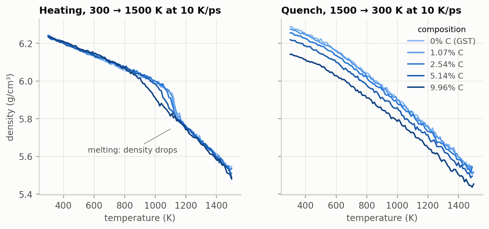

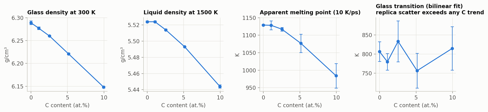

- **Density falls with C**, steadily and well outside the replica spread: −1.4% in the liquid, −2.2% in the glass.
- **The apparent melting point falls above 2.5% C.** It is the superheating limit on a 10 K/ps ramp, so an upper bound on
  the model's Tm, and its spread grows with C.
- **Tg is not resolved**: the bilinear fit scatters by 20–60 K between replicas, more than any composition effect.
- **Crystal-like order** (`xfracGST`, Ge/Sb/Te only, default criterion 3.6/0.5/4) falls slightly with C, to 0.133 at
  5% C; x10, the vacancy-free endpoint, reads 0.143.

## Structure of the glass

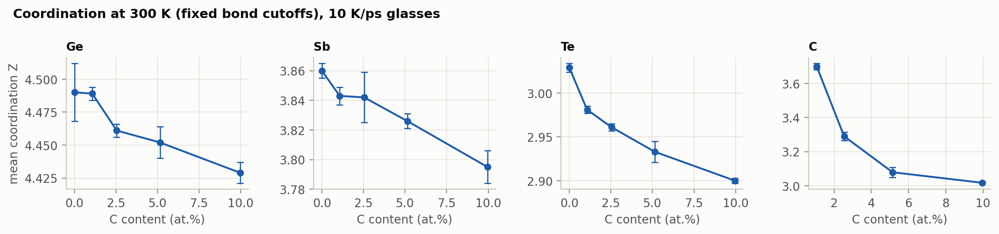

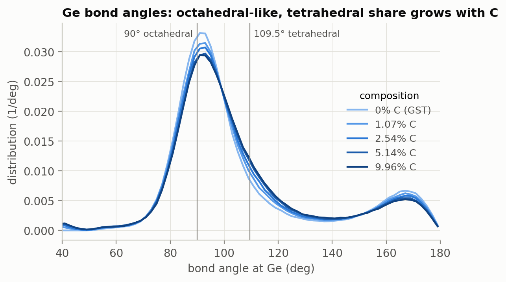

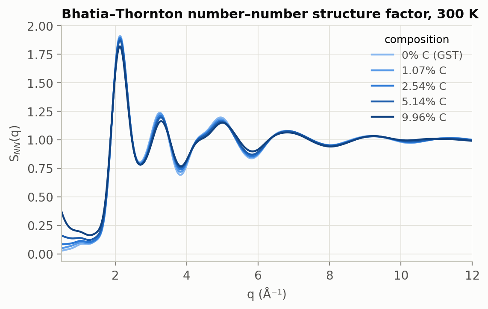

- Coordination drops slightly with C: Ge 4.49 → 4.43, Sb 3.86 → 3.80, Te 3.03 → 2.90. C is 3.70-coordinated at 1% C and
  3.02 at 10%.
- Ge bond angles peak at 91–93° (octahedral-like) for every composition; the 100–120° share (tetrahedral-like) rises
  from 0.19 to 0.25 with C.
- S_NN(q) barely changes beyond 2 Å⁻¹. At low q it rises with C, most for 10% C, consistent with the larger-scale
  density fluctuations a segregated C network brings (not analysed further).

## Carbon clustering

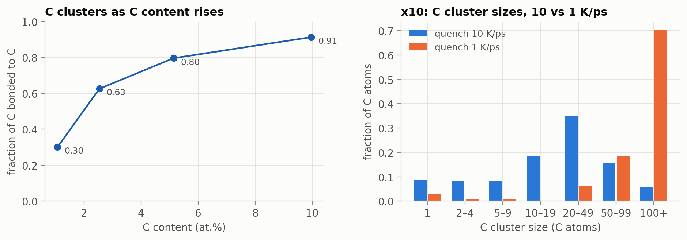

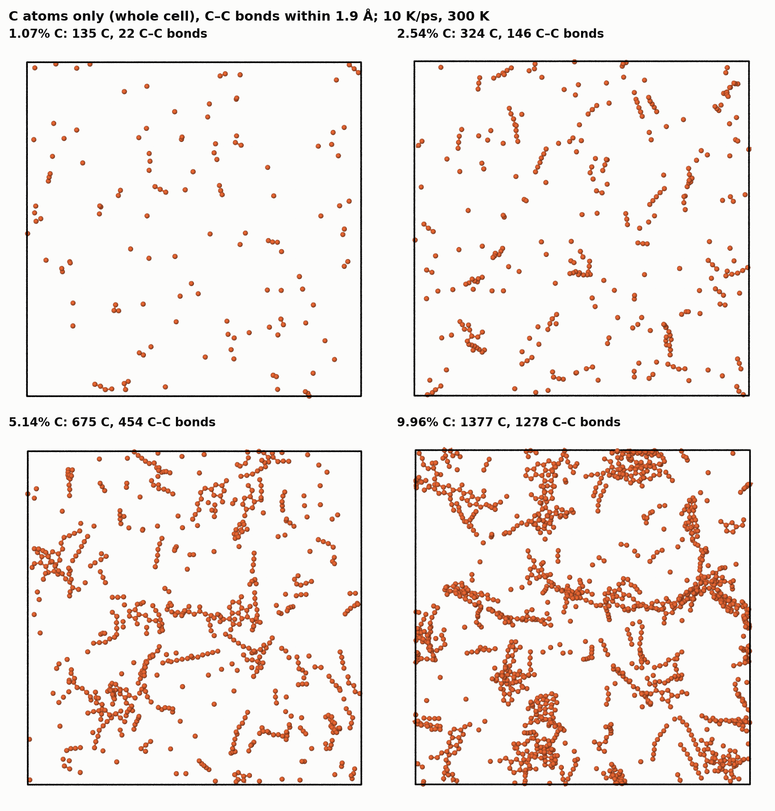

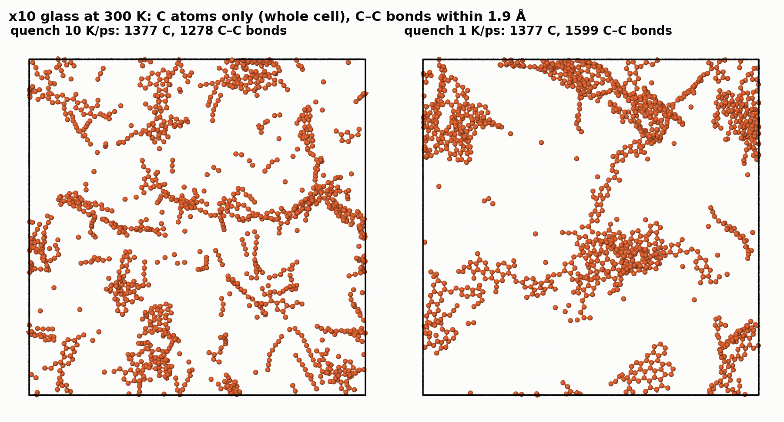

- The fraction of C bonded to C rises 0.30 → 0.63 → 0.80 → 0.91 (1 → 2.5 → 5 → 10% C). At 10% C, 75% of C sits in
  clusters of 10 or more atoms, up to 129.
- The commonest C environments change from Ge/Sb-rich (Ge₃Sb 19%, Ge₂C 13%, Ge₂Sb₂ 12% at 1% C) to C-rich (C₃ 22%, GeC₂
  21%, C₂ 15% at 10% C). C bonds to Ge before Sb before Te.
- Across compositions (renders, 10 K/ps): isolated C atoms and dimers at 1% C, short chains by 2.5%, branched and
  connected clusters at 5–10%. C–C bonds per C: 0.34, 0.90, 1.35, 1.84 (mean of 3 replicas).

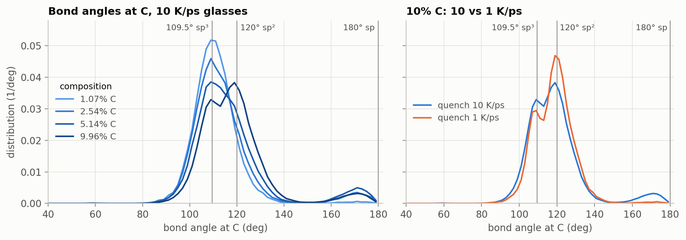

- **C bonding turns from tetrahedral toward planar.** At 1% C the C-centred bond angles peak at 109° (sp³-like; 59% of
  angles in 100–115°). At 10% C the main peak moves to 119° (sp²-like; 48% in 115–130°) as C bonds to other C,
  matching C's coordination falling from 3.70 to 3.02. A 1 K/ps quench pushes further toward planar (56% in 115–130°).
  A small near-linear population (~170°) appears from 2.5% C at 10 K/ps.

## Quench rate: 1 K/ps partially crystallizes

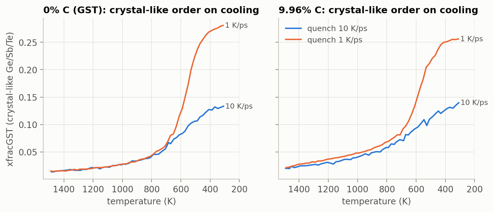

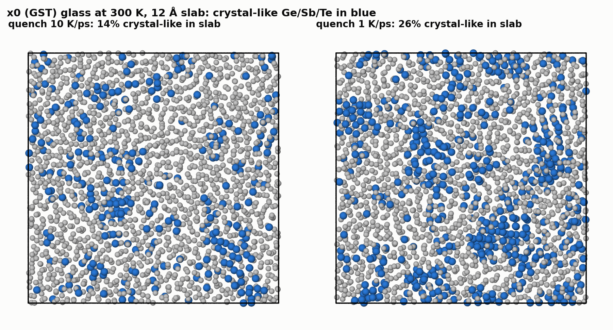

- `xfracGST` at 300 K is 0.28 (x0) and 0.26 (x10) after 1 K/ps, against 0.13–0.16 after 10 K/ps, and it rises during
  the quench between 600 and 400 K. The 1 K/ps glasses are partly crystallized, not merely better relaxed.
- Slower quenching also coarsens the C network (x10: 95% of C in clusters of 10 or more, up to 286 atoms).
- Glass density barely depends on rate (x0: 6.283 vs 6.289 g/cm³).

## Bond-cutoff check on the production x10 glass

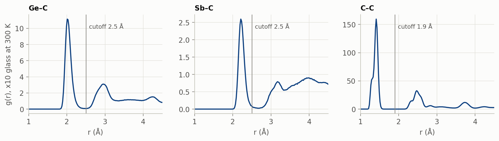

g_CC(1.9 Å) = 0 in all four x10 glasses. At 2.5 Å, g is 0.05–0.09 for Ge–C and Sb–C, on the tails of peaks at 2.0 and
2.2 Å; moving the cutoff by ±0.1 Å changes the C coordination of Ge by ≤ 2% and of Sb by 4–6%. The cutoffs stay.

## Caveats

- **Dense glass.** The model's glass (6.29 g/cm³) is denser than its own crystal (6.24), unlike experiment (glass ~6–7%
  less dense). This comes from its DFT reference (`tests/RESULTS.md` 1g, 1k), so density-dependent conclusions belong to
  that reference.
- **MD rates.** 10 K/ps and 1 K/ps are far faster than experiment; Tm_app is a superheating limit, and Tg depends on rate.
- **Crystal-like order is not crystallinity.** Even the 10 K/ps glasses hold crystal-like patches (up to a few hundred
  atoms); Part 3 accounts for this baseline.

## Provenance

Branch `part3`, Part 2 results commit 7a8138a. Runs in `meltquench/runs/<cell>_q<rate>_r<rep>`; analysis with
`analysis/mq_summary.py` and `analysis/mq_structure.py` (job 12309964).

## Rebuilding these documents

From the repository root:
- Figures: `env/cgst-ana/bin/python meltquench/report/make_figures.py` and `.../render_structures.py` (OVITO, software
  renderer). Colors are the dataviz reference palette, validated with its `validate_palette.js`.
- Report: `module load texlive/20220321`, then `latexmk -pdf part2_report.tex` in `meltquench/report/`.
- Slides: `node build_deck.js` with `pptxgenjs` on `NODE_PATH` and `PPTX_SKILL` set to the pptx skill directory (for
  `apply_theme.js`). Node and pptxgenjs are not part of `env/`; see the header of `build_deck.js`.
